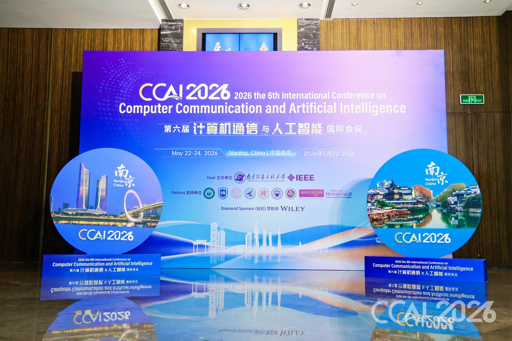

&emsp;&emsp;2026年第六届计算机通信与人工智能国际会议（CCAI 2026）于5月22-24日在中国南京召开，会议旨在搭建国际化学术交流平台，推动计算机通信与人工智能领域的技术创新与交流合作。CCAI 2026由南京信息工程大学与IEEE联合主办，会议以线上线下结合形式举行，聚焦计算机通信与人工智能交叉领域的前沿研究与技术创新。朱桂祥老师指导课题组4位本科生投稿CCAI2026，并携10余位本科学生参会。

&emsp;&emsp;课题组同学们认真听取了东南大学王江舟教授（中国工程院外籍院士，英国皇家工程院院士，IEEE Fellow）、东南大学王东明教授、中国能源研究会副理事长兼秘书长孙正运工程师作主旨报告，了解最前沿的有关人工智能和通信的学生研究工作，受益颇深。随后，课题组4位同学分别在分会场作了线上和线下汇报。

&emsp;&emsp;刘心瑶同学对在CCAI 2026上发表的题为“Interpretable Stacking Ensemble Framework for Imbalanced Financial Fraud Detection”论文作了现场汇报，针对金融欺诈检测存在数据类别失衡、模型预测缺乏可解释性的问题，提出了可解释堆叠集成检测框架IFD‑Stacking。采用SMOTEENN算法处理不平衡样本，通过Stacking集成多种异质机器学习模型提升欺诈识别能力，并借助SHAP方法完成模型结果可解释分析。在真实信用卡欺诈数据集上实验表明，该框架检测性能优于对比基线，同时可提供量化的特征贡献分析，满足金融风控对模型透明性的现实需求。

&emsp;&emsp;王方胜同学对在CCAI 2026上发表的题为“EL-DPTP: An Edge-Cloud Collaborative Framework for Real-Time Anomaly Prediction in College Fees”论文作了现场汇报，针对高校收费异常检测中实时性不足、时序特征挖掘不充分及边缘设备计算资源受限等问题，提出了一种基于边云协同的轻量化深度感知时序预测算法（EL-DPTP）。该算法融合轻量化数据预处理、多尺度时序注意力增强网络与动态优化策略，实现高校收费异常的实时预测与精准识别。基于2020—2024年某高校124.8万条收费时序数据的实验表明，该算法在异常检测准确率、召回率及F1值等指标上优于对比方法，为高校财务智能监管提供了高效、可行的技术方案。

&emsp;&emsp;欧聿芩同学对在CCAI 2026上发表的题为 "Deep Learning-Driven Intelligent THz Communications for 6G Urban Air Mobility: Channel Prediction and URLLC Assurance"论文作了现场汇报。她的工作针对太赫兹通信传播衰减严重、易受随机遮挡的难题，提出了基于LSTM的大气感知信道预测框架，将历史信道信息与实时气象数据相结合，实现主动式信道预测与预成束跟踪，从而保障URLLC的低时延高可靠要求。仿真结果表明，该方案在高动态城市环境下具有显著的性能优势，为6G空联网络的太赫兹通信优化提供了有效解决方案。

&emsp;&emsp;孟宇佳同学对在 CCAI会议上发表的题为 “FAS-Enabled Anti-SSDF Cooperative Spectrum Sensing: A Novel Physical-Layer Security Framework”的论文作了现场汇报。她的工作针对协作频谱感知易受频谱感知数据伪造（SSDF）协同攻击的难题，提出了基于流体天线系统 FAS 的物理层安全防御框架，利用天线位置动态重构带来的空间解相关特性，构建空间一致性检测机制与深度学习混合检测方案，实现恶意感知报告识别与安全融合，从而抑制协同智能 SSDF 攻击。仿真结果表明，该方案在多种攻击场景下具备优异的感知鲁棒性，为认知无线电网络协作频谱感知的物理层安全防护提供了有效解决方案。

&emsp;&emsp;本次参会不仅为课题组本科生提供了在国际学术会议上展示研究成果的宝贵舞台，也让同学们在与国内外专家学者交流中开阔了学术视野、锻炼了表达能力。四位同学的汇报获得与会专家肯定，充分体现了课题组在本科生科研培养方面的扎实成效。未来，课题组将继续坚持"以赛促学、以会促研"，鼓励更多学生投身科研实践，在AI+领域持续深耕、追求卓越。

新闻来源：[课题组新闻]
