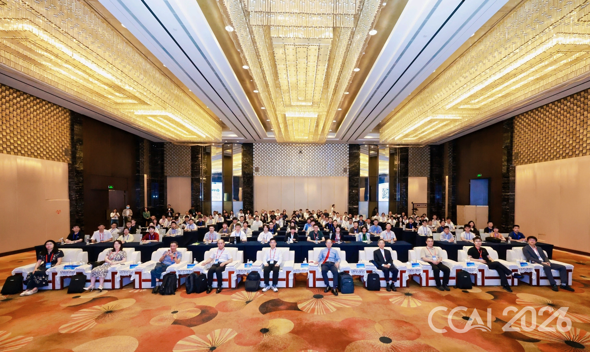
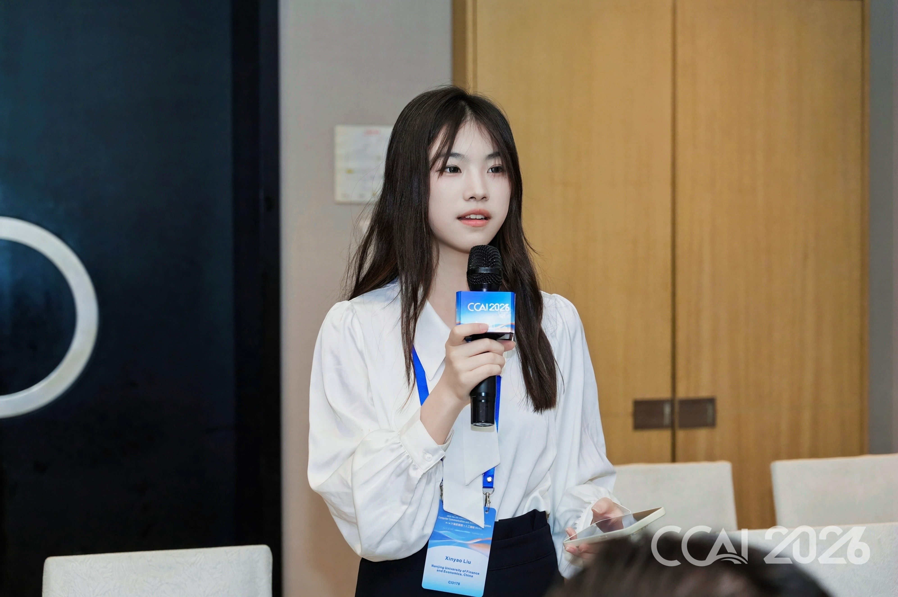
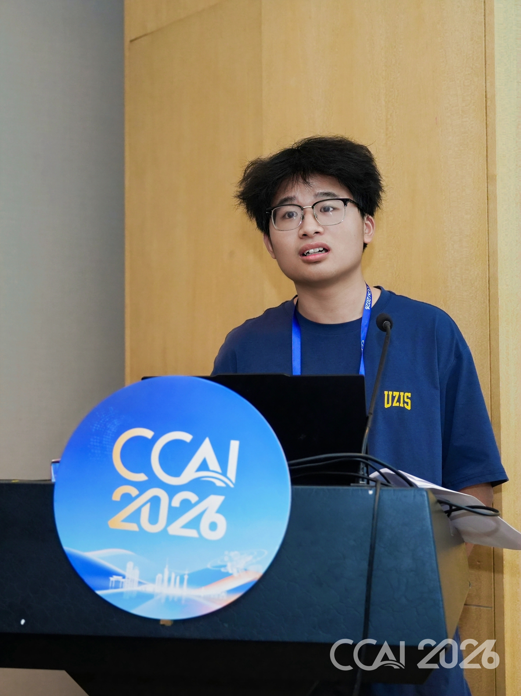

&emsp;&emsp;2026年第六届计算机通信与人工智能国际会议（CCAI 2026）于5月22-24日在中国南京召开，会议旨在搭建国际化学术交流平台，推动计算机通信与人工智能领域的技术创新与交流合作。CCAI 2026由南京信息工程大学与IEEE联合主办，会议以线上线下结合形式举行，聚焦计算机通信与人工智能交叉领域的前沿研究与技术创新。朱桂祥老师指导课题组4位本科生投稿CCAI2026，并携10余位本科学生参会。

&emsp;&emsp;课题组同学们认真听取了东南大学王江舟教授（中国工程院外籍院士，英国皇家工程院院士，IEEE Fellow）、东南大学王东明教授、中国能源研究会副理事长兼秘书长孙正运工程师作主旨报告，了解最前沿的有关人工智能和通信的学生研究工作，受益颇深。随后，课题组4位同学分别在分会场作了线上和线下汇报。

&emsp;&emsp;【课题组刘心瑶同学】对在CCAI 2026上发表的题为“”论文作了现场汇报，她提出了。。。

&emsp;&emsp;【课题组王方胜同学】对在CCAI 2026上发表的题为“”论文作了现场汇报，他提出了。。。

&emsp;&emsp;【课题组欧聿芩同学】对在CCAI 2026上发表的题为“”论文作了现场汇报，她的工作。。。

&emsp;&emsp;【课题组孟宇佳同学】对在CCAI 2026上发表的题为“”论文作了现场汇报，她的工作。。。

新闻来源：[课题组新闻]
