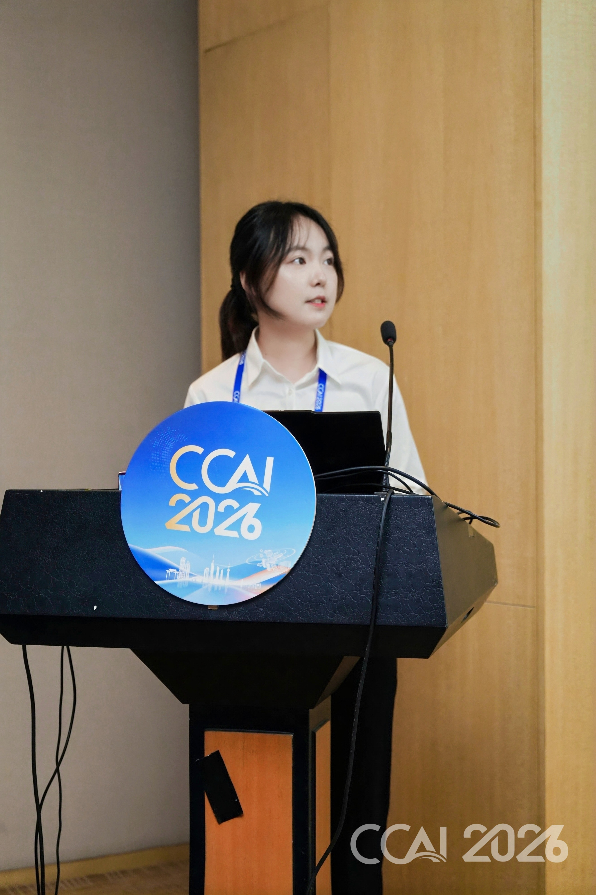

&emsp;&emsp;2026年第六届计算机通信与人工智能国际会议（CCAI 2026）于5月22-24日在中国南京召开，会议旨在搭建国际化学术交流平台，推动计算机通信与人工智能领域的技术创新与交流合作。CCAI 2026由南京信息工程大学与IEEE联合主办，会议以线上线下结合形式举行，聚焦计算机通信与人工智能交叉领域的前沿研究与技术创新。朱桂祥老师指导课题组4位本科生投稿CCAI2026，并携10余位本科学生参会。

&emsp;&emsp;课题组同学们认真听取了东南大学王江舟教授（中国工程院外籍院士，英国皇家工程院院士，IEEE Fellow）、东南大学王东明教授、中国能源研究会副理事长兼秘书长孙正运工程师作主旨报告，了解最前沿的有关人工智能和通信的学生研究工作，受益颇深。随后，课题组4位同学分别在分会场作了线上和线下汇报。

&emsp;&emsp;【课题组刘心瑶同学】对在CCAI 2026上发表的题为“”论文作了现场汇报，她提出了。。。

&emsp;&emsp;【课题组王方胜同学】对在CCAI 2026上发表的题为“”论文作了现场汇报，他提出了。。。

&emsp;&emsp;【课题组欧聿芩同学】对在CCAI 2026上发表的题为“”论文作了现场汇报，她的工作。。。

&emsp;&emsp;【课题组孟宇佳同学】对在CCAI 2026上发表的题为“”论文作了现场汇报，她的工作。。。

&emsp;&emsp;本次参会不仅为课题组本科生提供了在国际学术会议上展示研究成果的宝贵舞台，也让同学们在与国内外专家学者交流中开阔了学术视野、锻炼了表达能力。四位同学的汇报获得与会专家肯定，充分体现了课题组在本科生科研培养方面的扎实成效。未来，课题组将继续坚持"以赛促学、以会促研"，鼓励更多学生投身科研实践，在AI+领域持续深耕、追求卓越。

新闻来源：[课题组新闻]
