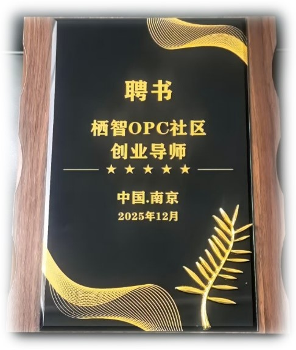

&emsp;&emsp;12月27日上午，“栖智OPC社区：AI赋能超级个体启航季”活动在南京市栖霞区紫东生态会议中心举办。活动以“AI赋能筑生态，超级个体启新程”为主题，标志着栖霞区在人工智能赛道再落关键一子，通过系统化布局、全链条支撑与开放式生态，全力激活区域创新经济新动能。朱桂祥老师携课题组6位本科生参会。

&emsp;&emsp;OPC，是“One Person Company”的简称，即“一人公司”——在AI协同支持下，个人可以独立完成从产品设计研发到市场投放的全链路闭环，即实现“单人成军”。活动现场，栖霞区正式发布了“栖智OPC社区”建设方案。该方案以具备全天候持续运作、全方位贴心周到、全托管省心便捷特点的“三全”服务作为社区建设的坚实支撑，以产学研协同人才培养作为社区发展的核心软实力。同时，凭借仙林大学城的资源优势，依托高校导师团队，并借助人工智能技术，对社区的发展路径进行系统规划。

&emsp;&emsp;现场还举行了首批创业者入驻仪式和创业导师聘任仪式，10位创业者领取入驻“钥匙”，11位产业与学界专家受聘为创业导师，形成“项目+人才+导师”三轮驱动的生态孵化模式，朱桂祥老师参加了启动仪式并受聘为栖智OPC社区创业导师。

&emsp;&emsp;会后，学子们实地参观“栖智·元力”社区，亲身感受为OPC创业者定制的活力空间与创新场景。

&emsp;&emsp;本次参会不仅为课题组本科生提供了产学研。。。。
新闻来源：[课题组新闻]
