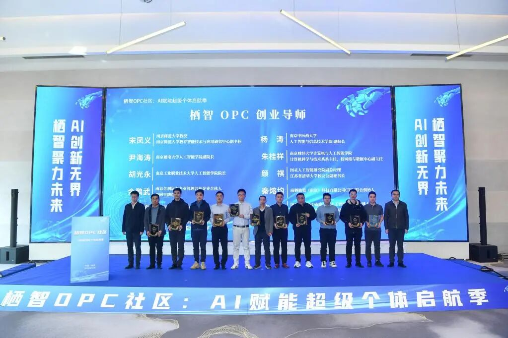
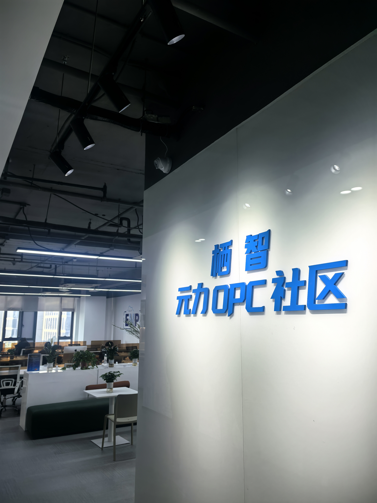

&emsp;&emsp;12月27日上午，“栖智OPC社区：AI赋能超级个体启航季”活动在南京市栖霞区紫东生态会议中心举办。活动以“AI赋能筑生态，超级个体启新程”为主题，标志着栖霞区在人工智能赛道再落关键一子，通过系统化布局、全链条支撑与开放式生态，全力激活区域创新经济新动能。朱桂祥老师携课题组6位本科生参会。

&emsp;&emsp;OPC，是“One Person Company”的简称，即“一人公司”——在AI协同支持下，个人可以独立完成从产品设计研发到市场投放的全链路闭环，即实现“单人成军”。活动现场，栖霞区正式发布了“栖智OPC社区”建设方案。该方案以具备全天候持续运作、全方位贴心周到、全托管省心便捷特点的“三全”服务作为社区建设的坚实支撑，以产学研协同人才培养作为社区发展的核心软实力。同时，凭借仙林大学城的资源优势，依托高校导师团队，并借助人工智能技术，对社区的发展路径进行系统规划。

&emsp;&emsp;现场还举行了首批创业者入驻仪式和创业导师聘任仪式，10位创业者领取入驻“钥匙”，11位产业与学界专家受聘为创业导师，形成“项目+人才+导师”三轮驱动的生态孵化模式，朱桂祥老师参加了启动仪式并受聘为栖智OPC社区创业导师。

&emsp;&emsp;会后，学子们实地参观“栖智·元力”社区，亲身感受为OPC创业者定制的活力空间与创新场景。社区内开放式工位、独立创作间、路演交流区等功能区域布局合理，AI工具终端、快速原型设备、共享拍摄与直播空间等配套设施一应俱全，充分契合“一人公司”轻量化、高效率、全链路的创业需求。同学们边走边看、边听边问，围绕AI辅助选题、智能内容生成、产品快速迭代、低成本市场验证等话题与现场工作人员深入交流，对“超级个体”如何在真实场景中落地有了更具体的认识。此次参观也让同学们意识到，人工智能不仅正在改变技术实现方式，也在重塑个人创造价值、组织资源和参与产业分工的方式，为今后开展创新创业实践提供了新的思路和启发。

&emsp;&emsp;本次参会不仅为课题组本科生提供了产学研深度对接的宝贵机会，也让同学们近距离感受到AI赋能下"一人公司"模式的创新活力与广阔前景。通过实地参观"栖智·元力"社区，同学们对AI技术如何助力个体实现从创意到产品的全链路闭环有了更直观的认识，对人工智能时代下的创新创业路径有了更清晰的思考。未来，课题组将继续鼓励同学们关注前沿技术动态，积极参与各类创新创业实践活动，在产学研协同育人的平台上不断提升实践能力与综合素养，努力成长为适应时代需求的复合型创新人才。

新闻来源：[课题组新闻]
