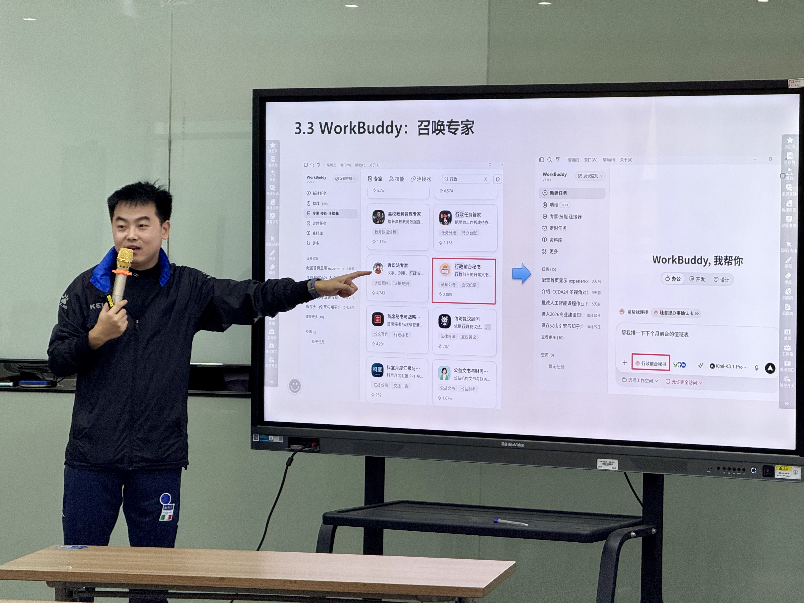
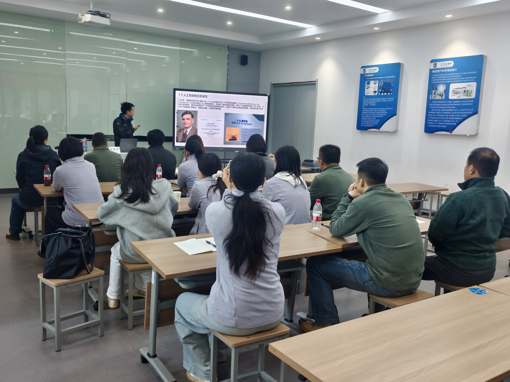

&emsp;&emsp;2026年11月7日，应南京市公务车辆服务中心邀请，南京财经大学计算机与人工智能学院朱桂祥副教授赴南京技师学院，作题为《AI智能体辅助办公——以ima与WorkBuddy为例》的专题培训讲座。南京市公务车辆服务中心近20名干部职工参加培训。

&emsp;&emsp;讲座围绕“拥抱AI：第三次人工智能兴起”“生产力革命：让AI从‘能说会道’到‘动手干活’”“ima+WorkBuddy：智能体辅助报告撰写和数据统计分析”“AI向善：AI使用边界和伦理监督”四个部分展开。朱桂祥从图灵测试与多模态大模型讲起，梳理人工智能发展脉络，阐释AI智能体从“提供建议”到“直接干活”的能力跃迁，并介绍以检索增强生成（RAG）知识库缓解模型幻觉、以ima知识管家与WorkBuddy执行智能体分工协同的工作原理。

&emsp;&emsp;结合日常办公场景，讲座演示了把微信文件、公众号文章、本地PDF与Word资料一键沉淀为可检索知识库，创建共享知识库、调用专家Skills生成文稿，以及数据表从导入、清洗、统计到可视化大屏、复核并生成分析报告的完整链路，强调重要数字、引用与政策必须回到原始材料双重核验。

&emsp;&emsp;讲座同时提醒，效率提升会放大隐私与授权、准确性与偏差、责任与可追溯、版权与机密四类风险，并给出五条可执行的规范：先分类数据、先设范围再执行、重要结论双重核验、透明披露AI参与、保留可追溯记录，判断标准是“是否尊重人的知情权、选择权与最终控制权”。

&emsp;&emsp;此次培训由南京市公务车辆服务中心组织，旨在提升部门干部和职工使用AI智能体辅助办公的能力，讲座反馈较好。

新闻来源：[电商AI+课题组]
