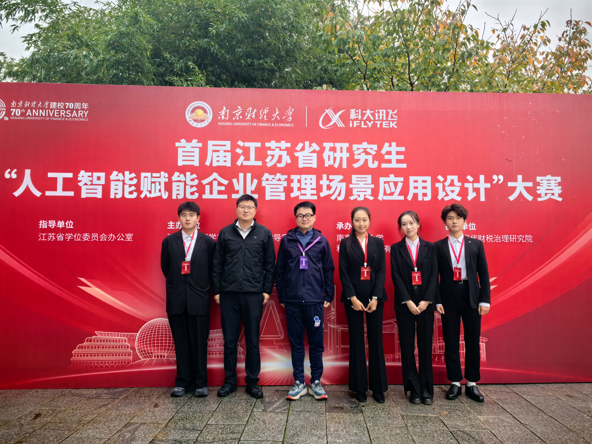
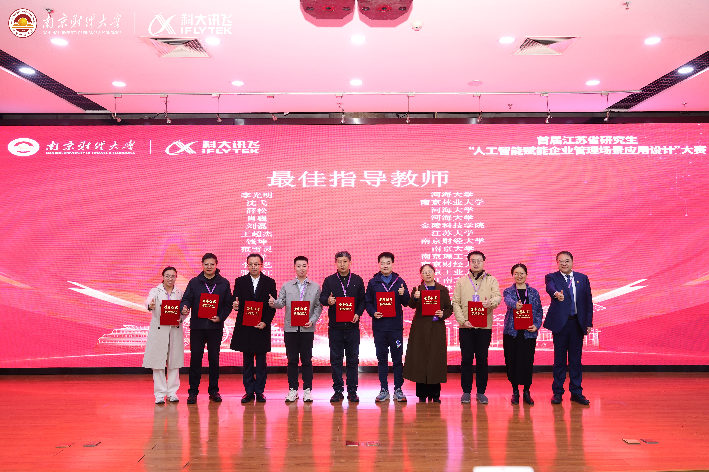
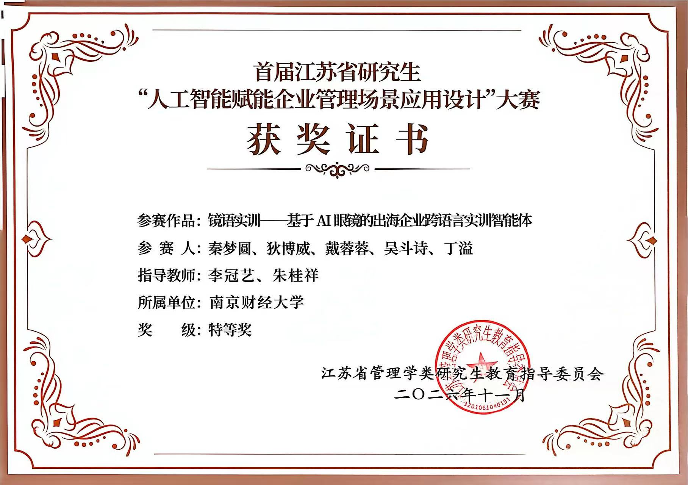
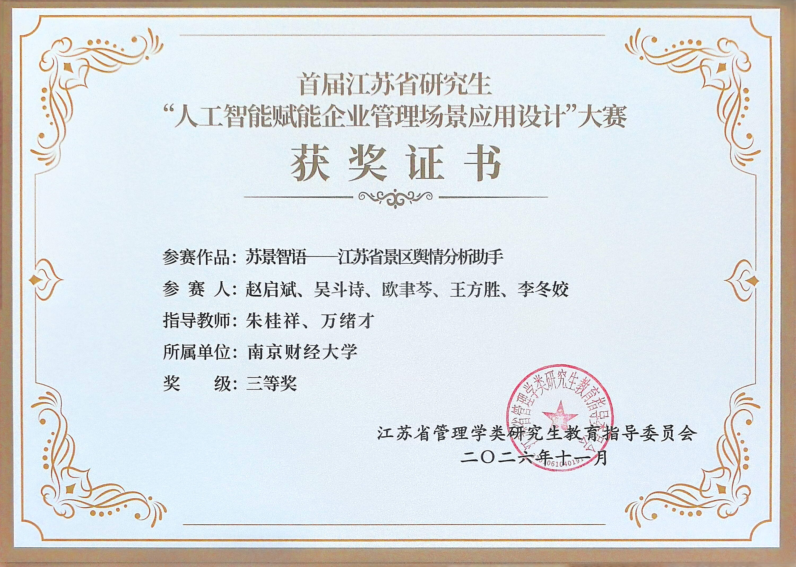
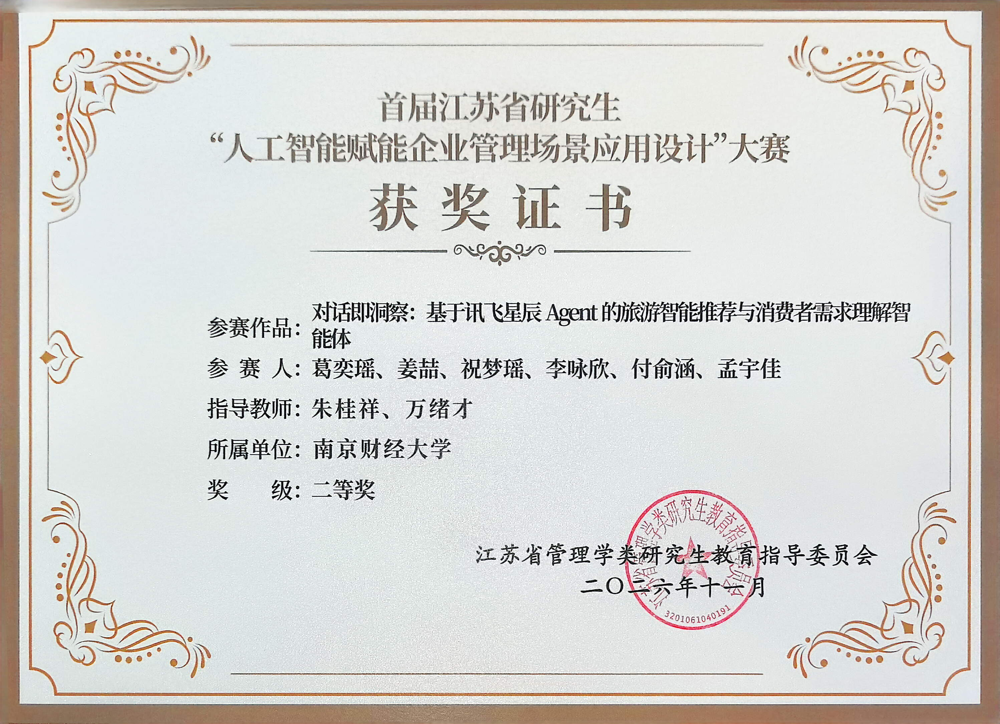

&emsp;&emsp;11月14日，首届江苏省研究生“人工智能赋能企业管理场景应用设计”大赛在我校仙林校区举行。本次大赛自启动以来，得到了省内高校的积极响应，共吸引来自南京大学、东南大学、河海大学、江南大学等的98支队伍参加，参赛学生430余人，指导教师166人。经过初赛评审，16支队伍脱颖而出，晋级决赛。各参赛团队聚焦企业经营管理中的真实问题，通过作品展示、现场汇报与答辩等环节，充分展现了运用人工智能技术解决实际管理问题的能力。评审团结合提交材料与现场表现，从真实场景与问题分析、专业理论应用与分析能力、AI工具设计与应用质量、解决效果与应用价值、规范性与风险控制等维度对参赛项目进行了严格评审，最终评定各奖项。课题组学子在该赛事表现优异，镜语实训（学生：秦梦圆、狄博威、戴蓉蓉、吴斗诗、丁溢；指导老师：李冠艺、朱桂祥）斩获特等奖，对话即洞察（学生：葛奕瑶、姜喆、祝梦瑶、李咏欣、付俞涵、孟宇佳；指导老师：朱桂祥、万绪才）斩落二等奖，苏景智语（学生：赵启斌、吴斗诗、欧聿芩、王方胜、李冬姣；指导老师：朱桂祥、万绪才）斩获三等奖，李冠艺和朱桂祥老师荣获赛事最佳指导老师。

&emsp;&emsp;【镜语实训】随着国内企业出海规模持续扩大，境外外方员工岗位培训的跨语言难题日益凸显，大量企业虽投入高额培训经费，却长期受口音障碍、专业术语翻译偏差、培训信息丢失等问题困扰，制约海外团队能力建设。为此，"镜语实训——基于AI眼镜的出海企业跨语言实训智能体"应运而生，项目构建四层协同系统，将轻量化AI眼镜作为一线员工的沉浸式显示终端，依托大模型搭建可自定义的企业垂域知识库，利用独特分页技术实现专业内容双语对照展示，并通过解耦式架构完成多品牌AI硬件适配。项目经大规模问卷、访谈、网络评论三元调研验证市场需求，技术层面拥有软件著作权，产业端联动大模型厂商与AI眼镜硬件企业，落地端对接出海企业推进试点，并荣获首届江苏省研究生"人工智能赋能企业管理场景应用设计"大赛特等奖；团队计划以灯塔客户为起点，逐步向航运、能源、跨境电商等行业规模化拓展，持续迭代产品，打造出海企业跨语言岗位培训标杆方案。

&emsp;&emsp;【对话即洞察】随着旅游消费需求日趋多元，传统推荐依赖点击、浏览等历史行为，难以及时捕捉游客在交流中表达的个性化需求，游客也常面临"需求说不清、产品找不准、推荐看不懂"的困扰，因此"对话即洞察——基于讯飞星辰Agent的消费者需求理解与旅游智能推荐智能体"项目应运而生：项目依托讯飞星辰Agent平台，将自然语言对话与真实旅游产品检索相结合，提供个性化推荐、产品介绍和旅游问答服务，并从对话中提取消费需求信号，为旅游平台优化产品与营销决策提供参考；目前已完成核心工作流搭建，关键能力通过单节点测试，并在首届江苏省研究生"人工智能赋能企业管理场景应用设计"大赛中荣获二等奖，后续将以具体目的地和旅游产品品类为切入点，持续优化推荐准确性与服务稳定性，探索面向中小型旅游平台的应用路径，为人工智能赋能旅游营销管理与消费者洞察提供实践参考。

&emsp;&emsp;【苏景智语】随着江苏5A级景区数量居全国前列、节假日客流高度集中，景区管理方与文旅主管部门长期受舆情信息分散、负面发现滞后、处置缺乏量化依据、整改难以闭环等问题困扰，人工筛查低效且口径不一。"苏景智语——基于讯飞星辰Agent平台的景区舆情分析智能体"由此应运而生，面向景区管委会、文旅集团与区县文旅局三类主体，采用"数据—引擎—应用—用户"四层协同架构，嵌入危机管理4R理论、SERVQUAL模型与PDCA闭环方法，以Excel评论直传为入口，经清洗脱敏、情感分析、七维度归类、主题聚类与红橙蓝三级预警六步流程自动生成舆情日报与处置建议，并配套知识库问答智能体提供预警标准、政策依据与话术咨询、对无关话题刚性拒答。项目以携程平台江苏十三市214,382条真实评论（覆盖696个景点）为底座形成舆情真值基准，经梯度样本对账与千条压力测试，日报数字与本地真值一致、预警分级路由正确，问答智能体通过三类验收；定位为"专业分析为本、AI工具为用"，把分散舆情信号转化为可决策、可追踪、可考核的结构化信息，团队计划以重点监测景区为灯塔起点，逐步推广至全省文旅系统并平移至博物馆、商圈、酒店等业态，打造文旅数治场景下的舆情管理标杆方案。

&emsp;&emsp;下一步，课题组将持续深化创新创业教育改革，依托科创训练营、科创种子团队孵化、行业专家专题指导等系列举措，进一步激发学生科创参赛热情，不断完善跨学院、跨学科协同育人机制，着力培育更多兼具技术能力、创新精神与实践能力的复合型人才，为学校高质量发展注入计算机力量。

新闻来源：[课题组新闻]
