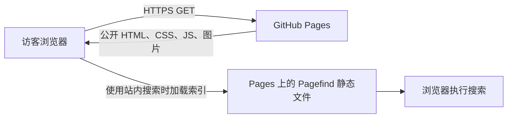
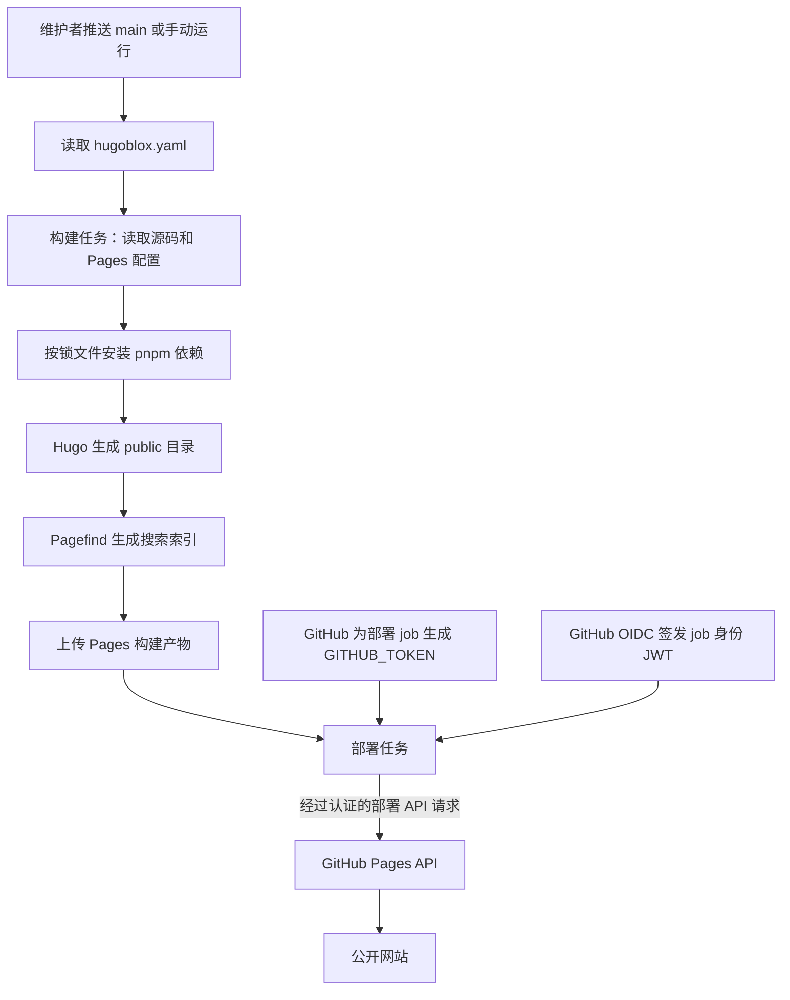

# 认证、请求与部署流程

本仓库将 HugoBlox Academic CV 构建为公开静态主页，目标地址为 <https://zgx881205.github.io/GuixiangZhu.github.co/>。当前代码没有网站账号、密码校验、登录 API、会话数据库或访问令牌签发服务。身份认证发生在维护者修改 GitHub 仓库以及 GitHub Actions 发布网站时；访客阅读主页无需登录。

本文依据当前仓库配置；源码链接指向 `main`。HugoBlox 模块和第三方 Action 的实现链接使用当前依赖的提交或版本。

## 组件与职责

| 组件 | 作用 | 认证边界与源码 |
| --- | --- | --- |
| 内容与作者资料 | Markdown 页面、个人资料、图片和公开附件 | `data/authors/`、`content/` 是发布内容，不是认证用户数据库。 |
| Hugo 与 HugoBlox | 构建时将内容、主题和配置生成静态文件 | [模块版本](https://github.com/zgx881205/GuixiangZhu.github.co/blob/main/go.mod#L5)；[Hugo 0.162.0 与 Pages 目标](https://github.com/zgx881205/GuixiangZhu.github.co/blob/main/hugoblox.yaml#L1)。 |
| Pagefind | 构建搜索索引，由浏览器加载和搜索 | [构建脚本](https://github.com/zgx881205/GuixiangZhu.github.co/blob/main/package.json#L7)；不需要搜索服务账号或 API key。 |
| GitHub Pages | 向访客提供生成的 HTML、CSS、JS 和资源 | [站点地址](https://github.com/zgx881205/GuixiangZhu.github.co/blob/main/config/_default/hugo.yaml#L8)；当前是公开静态站点。 |
| Actions 构建任务 | 读取源码和 Pages 配置、安装依赖、生成并上传 `public/` | [只读权限](https://github.com/zgx881205/GuixiangZhu.github.co/blob/main/.github/workflows/build.yml#L19)；[构建和上传](https://github.com/zgx881205/GuixiangZhu.github.co/blob/main/.github/workflows/build.yml#L127)。 |
| Actions 部署任务 | 将构建产物发布到 Pages | [独立部署权限与环境](https://github.com/zgx881205/GuixiangZhu.github.co/blob/main/.github/workflows/deploy.yml#L68)；使用临时 `GITHUB_TOKEN` 和 OIDC JWT。 |

## 访客请求流程

页面没有登录跳转、身份验证回调、服务端会话或请求级鉴权。浏览器能够请求的发布文件都是公开内容；文章、简历、附件和搜索索引中均不应放入秘密。[Pagefind 构建入口](https://github.com/zgx881205/GuixiangZhu.github.co/blob/main/package.json#L10)将索引写入站点输出目录。

## 构建和部署流程

1. [`deploy.yml`](https://github.com/zgx881205/GuixiangZhu.github.co/blob/main/.github/workflows/deploy.yml#L3)在推送 `main` 或手动运行时开始；`config` job 读取 `deploy.host`。当前目标为 `github-pages`。
2. `build` job 调用本仓库的可复用 [`build.yml`](https://github.com/zgx881205/GuixiangZhu.github.co/blob/main/.github/workflows/deploy.yml#L59)，仅授予 `contents: read` 和 `pages: read`，没有 `secrets: inherit`。PR 构建也使用这个只读构建工作流，不执行部署 job。
3. 构建任务使用 Node 22、pnpm 和 Hugo Extended；[`pnpm install --frozen-lockfile`](https://github.com/zgx881205/GuixiangZhu.github.co/blob/main/.github/workflows/build.yml#L82)要求依赖与锁文件一致。`configure-pages@v5`读取 Pages 的基础 URL，Hugo 和 Pagefind 生成公开文件，`upload-pages-artifact@v4`仅上传 `public/`。
4. [`deploy` job](https://github.com/zgx881205/GuixiangZhu.github.co/blob/main/.github/workflows/deploy.yml#L68)等待构建完成，仅在目标为 Pages 时运行，并使用 `github-pages` environment。它单独申请 `pages: write` 与 `id-token: write`；工作流全局默认权限仍为 `contents: read`。
5. [`deploy-pages@v4`](https://github.com/actions/deploy-pages/blob/v4/src/index.js#L20)通过 `core.getIDToken()`获取 OIDC JWT；[API 客户端](https://github.com/actions/deploy-pages/blob/v4/src/internal/api-client.js#L116)使用 GitHub token 认证，并向 Pages 部署 API 提交构建产物 ID、构建版本和 `oidc_token`。Pages 校验工作流来源后发布文件。

首次发布前，仓库的 **Settings → Pages → Source** 需要设为 **GitHub Actions**。当前 `configure-pages`步骤用于读取配置，没有申请管理仓库或首次启用 Pages 的权限。参见 [GitHub Pages 自定义工作流文档](https://docs.github.com/en/pages/getting-started-with-github-pages/using-custom-workflows-with-github-pages)。

## 凭证和令牌如何处理

| 凭证 | 来源、用途与生命周期 |
| --- | --- |
| 维护者的 GitHub 登录凭证 | 用于访问 GitHub 和修改仓库，由 GitHub 或维护者的 Git 客户端管理，不属于网站运行时。此配置不要求把个人密码、PAT 或 SSH 私钥写进仓库。 |
| `GITHUB_TOKEN` | GitHub 为每个 Actions job 自动创建的仓库级临时凭证，可通过 `github.token`使用。配置和构建 job 为只读；部署 job 获得 `pages: write`。job 结束或达到有效最长寿命时失效。无需手动建立同名 repository secret。 |
| OIDC JWT | 部署 job 凭 `id-token: write`按需向 GitHub OIDC 服务申请，用于证明工作流、分支等来源。它与允许调用 Pages API 的 `GITHUB_TOKEN`用途不同；两者都是部署过程中使用的凭证，不交给访客。 |
| `HUGO_BLOX_LICENSE`（上游可选） | 上游模板原本支持通过 secret 注入此环境变量，用于 Premium attribution 设置。当前免费配置已移除此注入，构建不需要购买许可证或配置该 secret。 |

`GITHUB_TOKEN`的自动签发、仓库范围和失效规则见 [GitHub 官方文档](https://docs.github.com/en/actions/concepts/security/github_token)。两个部署权限的区别与 OIDC 校验见 [`deploy-pages` v4 文档](https://github.com/actions/deploy-pages/blob/v4/README.md#oidc)。

配置任务和构建任务均明确设置 [`persist-credentials: false`](https://github.com/zgx881205/GuixiangZhu.github.co/blob/main/.github/workflows/build.yml#L37)（[配置任务对应设置](https://github.com/zgx881205/GuixiangZhu.github.co/blob/main/.github/workflows/deploy.yml#L26)）。`checkout@v6`在拉取代码时使用 token，完成拉取后不为后续 Git 命令保留认证配置；这不等于撤销当前 job 自身的 `GITHUB_TOKEN`。其[认证实现](https://github.com/actions/checkout/blob/v6/src/git-auth-helper.ts)使用临时凭证配置及 HTTP 认证头，并提供清理逻辑。

当前锁定的 Blox 模块在[页脚模板 `61f41d3667f1`](https://github.com/HugoBlox/kit/blob/61f41d3667f1/modules/blox/layouts/_partials/site_footer.html#L16)中读取可选 `HUGO_BLOX_LICENSE`、检查 UUID 格式，并决定是否允许隐藏 attribution。这是构建时的展示设置，不是访客认证；该代码没有把许可证字符串输出到网页。

构建和部署凭证仅供 Actions 任务调用 GitHub 服务。工作流没有将这些值写入 `public/`；仍应避免在 Markdown、前端 JS、静态文件、构建日志或生成索引中输出秘密。[`.gitignore`](https://github.com/zgx881205/GuixiangZhu.github.co/blob/main/.gitignore#L35)排除了常见本地 `.env`文件，但忽略规则本身不提供加密或访问控制。

## 辅助工作流及静态站点限制

- [`upgrade.yml`](https://github.com/zgx881205/GuixiangZhu.github.co/blob/main/.github/workflows/upgrade.yml#L18)和 [`import-publications.yml`](https://github.com/zgx881205/GuixiangZhu.github.co/blob/main/.github/workflows/import-publications.yml#L4)分别维护依赖和导入论文，需要 `contents: write`、`pull-requests: write`以创建修改和 PR。这些独立任务的写权限不会授予普通构建或网页访客；其 GitHub token 同样由 Actions 管理。
- `content/authors/`和 `data/authors/`只描述展示用作者。新增一个作者文件不会创建可登录账号。
- 引入的 [Netlify integration](https://github.com/HugoBlox/kit/blob/ef8ed449c7e8/modules/integrations/netlify/README.md)仅生成 Netlify 用的 `_headers`和 `_redirects`。GitHub Pages 不会因此获得 Netlify Identity、Basic Auth 或这些文件定义的响应头策略。
- 隐藏链接、删除导航或前端判断不能保护已发布文件。私有资料、会员权限、登录后内容和服务端秘密处理需要另行接入具有身份验证与授权能力的服务。
